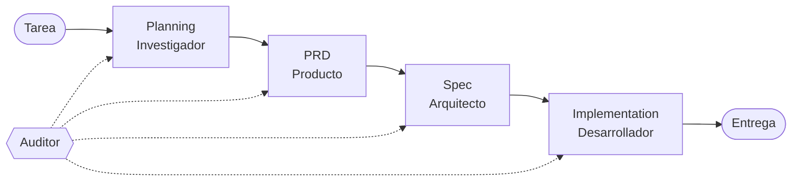

# AGORA

**Fecha:** 2026-11-12.
**Alcance:** qué es AGORA, cómo responde al reto *Research Agent Teams*, cómo se instala y ejecuta,
y qué evidencia hay de que funciona con un modelo real.

AGORA (Arquitectura de Gestión y Orquestación de Razonamiento Agéntico) es un sistema multiagente
escrito en Python, sin frameworks de agentes. Recibe una tarea de software, la investiga, la
especifica, la implementa y audita cada paso. Cuando el auditor rechaza un resultado, la fase se
repite con el veredicto como retroalimentación.

## 1. Flujo



Cada fase la ejecuta un agente experto que entrega un **artefacto**: un documento JSON validado con
Pydantic (`ResearchBrief`, `PRD`, `Spec`, `Implementation`). Los artefactos se enlazan por
identificadores: cada pedido del usuario (`ASK`) lo cubre un requisito (`REQ`), cada requisito una
prueba planeada (`T`), y cada prueba tiene un resultado medido con pytest.

## 2. Respuesta a cada punto del reto

| El reto pide | Dónde está | Archivo |
|---|---|---|
| Orquestador en streaming | Generador asíncrono que entrega un evento por cada paso mientras los agentes trabajan | `orchestrator.py` |
| Al menos tres agentes expertos | Cuatro: Investigador, Producto, Arquitecto y Desarrollador | `agent.py`, `developer.py`, `prompts.py` |
| Delegación | Cada tarea lista se entrega al agente de su nombre, con los artefactos de sus dependencias como entrada | `orchestrator.py` |
| Seguimiento de tareas | Tablero con máquina de estados (transiciones permitidas en una tabla), dependencias como grafo y guardado en SQLite | `board.py`, `store.py` |
| Reglas de validación y agente auditor | Esquema Pydantic por artefacto y reglas en código por fase: cobertura `ASK → REQ → T`, referencias colgantes, archivos Python, pruebas ejecutadas y aprobadas | `contracts.py`, `auditor.py` |
| Re-ejecución | Reintento del agente con el error de validación (hasta 3) y repetición de la fase con el veredicto del auditor (hasta 3) | `agent.py`, `orchestrator.py` |
| Registro, excepciones y rastreo por agente | Una línea JSON por evento, errores propios por tipo de fallo y versiones de cada artefacto en SQLite | `eventlog.py`, `errors.py`, `store.py` |
| Punto de entrada donde el usuario ve y pide cambios | Terminal con el árbol de tareas en vivo, tabla de trazabilidad al final y `--change` con confirmación y cascada | `cli.py`, `terminal.py` |

El principio que ordena todo: **el modelo propone y el código dispone**. Las decisiones que
gobiernan el proceso (qué se acepta, qué se repite, cuándo se detiene) están en código y tienen
pruebas, de modo que el comportamiento del sistema se puede probar sin gastar tokens.

## 3. Instalación

Requiere Python 3.12 o superior. En Windows (PowerShell):

```powershell
py -m venv .venv
.venv\Scripts\Activate.ps1
pip install -e ".[dev]"
copy .env.example .env
```

## 4. Ejecución

**Con el modelo simulado**, sin tokens:

```powershell
python -m agora
```

Ejecuta las cuatro fases sobre una tarea de ejemplo (un inventario de productos). El guion del
simulado hace que el primer PRD olvide un pedido del usuario: el auditor lo rechaza y el segundo
intento pasa. El código generado queda en `workspace/<ejecución>/` y el registro de eventos en
`logs/<ejecución>.jsonl`.

**Con un modelo real**, con `OPENROUTER_API_KEY` y `OPENROUTER_MODEL` en `.env`:

```powershell
python -m agora --real "Una API para consultar un inventario de productos y filtrarlos por categoria"
```

**Reanudar** una ejecución interrumpida, sin repetir lo aprobado:

```powershell
python -m agora --run-id <ejecución> --resume
```

**Pedir un cambio** a una ejecución terminada. Entra por la fase indicada, muestra qué se rehace y
pide confirmación:

```powershell
python -m agora --run-id <ejecución> --change prd "Agregar busqueda por nombre"
```

## 5. Evidencia con modelo real

Se hicieron trece ejecuciones con dos modelos de OpenRouter. Cada falla se documentó con su causa
antes de cambiar código o prompts, y desde la quinta ejecución cada cambio se probó con al menos
dos ejecuciones, porque el modelo varía entre llamadas. El registro completo está en
[docs/hallazgos-modelo-real.md](docs/hallazgos-modelo-real.md).

La ejecución `real-13`, con `qwen/qwen3-coder-30b-a3b-instruct`, completó la cadena:

| Fase | Resultado |
|---|---|
| Planning y PRD | Aprobados al primer intento: 2 pedidos, 2 requisitos |
| Spec | Rechazada por planear pruebas sin archivo de pruebas; aprobada en el segundo intento |
| Implementation | Rechazada dos veces (la primera, por importar Flask, que no está instalado); aprobada en el tercer intento |

Al repetir pytest sobre el código generado pasan 12 pruebas, entre ellas las 7 planeadas en la Spec.

Los hallazgos principales fueron que un veredicto sin causa no permite al modelo corregirse, que un
concepto sin definir en el prompt queda a interpretación del modelo, y que un defecto detectado en
una fase puede nacer en una anterior.

## 6. Código

| Módulo | Responsabilidad |
|---|---|
| `contracts.py` | Artefactos de cada fase como modelos Pydantic |
| `llm.py`, `openrouter.py` | Conector de modelos, modelo simulado y cliente de OpenRouter con reintentos |
| `agent.py` | Agente base: llama al modelo, valida y reintenta con el error |
| `developer.py` | Desarrollador: escribe el código en la carpeta de trabajo y mide sus pruebas con pytest |
| `board.py`, `store.py` | Tablero de tareas, máquina de estados, dependencias y persistencia |
| `orchestrator.py` | Delegación, auditoría por fase, re-ejecución y eventos |
| `auditor.py` | Reglas en código y veredicto con evidencia |
| `search.py`, `workspace.py` | Búsqueda en Tavily, escritura acotada y pytest con límite de tiempo |
| `cli.py`, `terminal.py`, `eventlog.py` | Punto de entrada, árbol en vivo, entrega y registro |
| `demo.py`, `prompts.py` | Guion del modelo simulado e instrucciones de cada experto |

## 7. Verificación

```powershell
ruff check .
pytest
```

Las pruebas usan el modelo simulado y respuestas HTTP grabadas: no llaman a ningún servicio externo.

## 8. Documentos

- [docs/arquitectura.md](docs/arquitectura.md): arquitectura en breve, para revisión.
- [docs/arquitectura-detalle.md](docs/arquitectura-detalle.md): diseño completo, con notas de lo que
  cambió al implementarse.
- [docs/hallazgos-modelo-real.md](docs/hallazgos-modelo-real.md): ejecuciones con modelo real,
  causas y decisiones.

## 9. Límites conocidos

- Las reglas que requieren comparar significados (por ejemplo, que cada pedido aparezca en la tarea
  original) necesitan un juez con modelo, que no está implementado.
- La fase de Planning no usa todavía la búsqueda web; sus fuentes no se verifican.
- Una fase rechazada se repite a sí misma; no sube a la fase anterior cuando el defecto nace antes.
- El reintento recibe solo el último veredicto, y el modelo puede oscilar entre errores ya
  corregidos.
- El costo de cada ejecución no se registra.
- El código generado se ejecuta sin aislamiento, solo acotado a su carpeta de trabajo.
