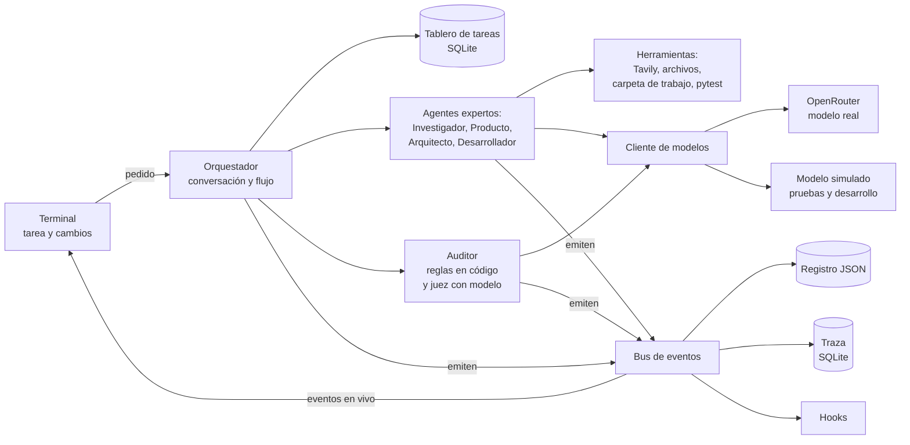
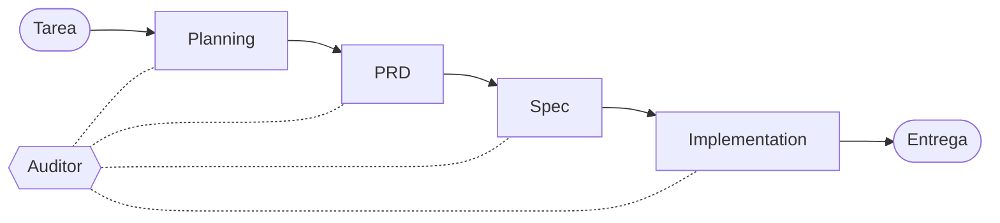
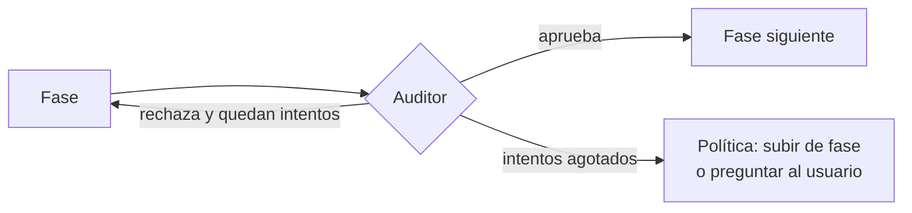

# Arquitectura de AGORA en detalle
**Fecha:** 2026-11-10.

**Alcance:** Descripción detallada de la arquitectura de AGORA (Arquitectura de Gestión y Orquestación de Razonamiento Agéntico),
el sistema multiagente que responde al reto técnico *Research Agent Teams*: qué produce cada fase,
quién decide el flujo, cómo se registran las tareas, cómo se manejan los fallos, qué valida el
auditor, cómo se observa la ejecución y cómo pide cambios el usuario. Cierra con el plan de bloques
de construcción. Lo marcado `[POR CONFIRMAR]` es una propuesta sin decidir. La versión breve, para
revisión, está en [arquitectura.md](arquitectura.md).

---

## 1. El reto

El reto solicita la construcción de un *harness* multiagente: un sistema que recibe una tarea de
software de tamaño medio, la reparte entre agentes especializados y entrega una solución mínima que
funciona (un MVP, *minimum viable product*). El trabajo debe seguir cuatro fases:

- Planning.
- Product Requirements Document (PRD).
- Specifications (Spec).
- Implementation.

Los requisitos técnicos son:

- Un **orquestador** con el que se interactúa solo mediante respuestas en *streaming* (la
  respuesta llega por partes mientras se genera), con acceso a al menos tres agentes expertos.
- Cada agente experto con **registro**, **manejo de excepciones** y **rastreo** (*traceback*).
- **Reglas de validación** y un **agente auditor** que revisa los pasos contra esas reglas.
- Un **punto de entrada** (terminal o interfaz simple) donde el usuario escribe la tarea, ve lo
  implementado y pide cambios.

La evaluación se centra en la delegación entre agentes, el seguimiento de tareas, la auditoría y la
re-ejecución, escritos por cuenta propia. No se evalúan la calidad de las respuestas del modelo ni
su elección.

### 1.1 Los tres niveles

La tarea no la define AGORA: la escribe el usuario cada vez que lo usa. AGORA debe resolver
cualquier tarea de tamaño medio, no solo las de ejemplo.

| Nivel | Qué es | Ejemplo |
|---|---|---|
| El sistema | AGORA, el código que se entrega y se evalúa | El orquestador, los agentes y el auditor |
| La entrada | La tarea en lenguaje natural, con archivos de apoyo opcionales | "Una API para consultar una base simulada de inventario" |
| La salida | El MVP generado, junto con el plan, el PRD y la Spec que llevaron a él | Código de la API, base simulada y pruebas |

El diseño se asemeja a la relación de un compilador con sus programas, se escribe el compilador y se prueba con
programas de ejemplo, sin hacerlo a la medida de ninguno.

### 1.2 Supuestos

- El MVP generado es siempre un proyecto de Python de pocos archivos, con pruebas de pytest que
  AGORA ejecuta. Así el auditor dispone de una señal objetiva de que el código funciona.
- La investigación forma parte de la fase de Planning: un agente consulta los archivos que el
  usuario adjunta y la web, mediante Tavily.
- `[POR CONFIRMAR]` En la presentación, los evaluadores podrían dar la tarea en vivo. El diseño
  lo asume, y por eso no admite nada hecho a la medida de una tarea concreta.

## 2. El principio de diseño

La solución propuesta se fundamenta en un principio de **gobernabilidad: delegar al modelo de lenguaje el trabajo cognitivo y creativo, mientras que el sistema conserva el control sobre la ejecución**. El modelo se encarga de actividades como investigar, redactar requisitos, diseñar soluciones y generar código. El sistema, mediante código, determina cómo se desarrolla el proceso: establece el flujo de ejecución, valida la estructura de los resultados, contabiliza los intentos y aplica las políticas de recuperación ante fallos.

Esta separación también permite incorporar un segundo principio: la **observabilidad**. Que un modelo sea capaz de resolver una tarea de principio a fin no significa que esa sea necesariamente la mejor forma de abordarla, especialmente cuando no es posible observar cómo se desarrolló el trabajo, identificar dónde falló o determinar cómo mejorarlo. Al dividir el proceso en fases con resultados estructurados, se establecen puntos de control que permiten identificar en qué etapa ocurrió un problema, qué regla se incumplió y qué acción debe ejecutarse a continuación.

De esta manera, las decisiones que gobiernan el proceso no quedan exclusivamente en manos del modelo, sino que se expresan mediante reglas implementadas en código. Esto permite probar el comportamiento del sistema de forma independiente al modelo de lenguaje, utilizando modelos simulados para verificar los flujos de ejecución, las validaciones y las políticas de recuperación.

Para implementar esta organización, el diseño distingue tres conceptos fundamentales:

- **Fase:** representa una etapa del proceso de trabajo, como planificación, definición de requisitos, especificación técnica o implementación.
- **Agente:** es el ejecutor especializado de una fase. Está compuesto por un modelo de lenguaje, un rol definido, las herramientas que tiene disponibles y un esquema que establece la estructura del resultado que debe producir.
- **Tarea:** representa una unidad concreta de trabajo dentro del tablero de ejecución. Registra qué debe realizarse, quién es responsable, su estado y los intentos realizados durante su ejecución.

Esta distinción permite separar el proceso, los responsables y las unidades de trabajo que lo componen. Cada fase es ejecutada por un agente especializado y genera una tarea por cada ejecución, cuyo artefacto, una vez aprobado, se convierte en el insumo de la fase siguiente.

De manera complementaria, el sistema incorpora una **unidad especializada de auditoría** (el agente auditor que pide el reto), cuya responsabilidad es supervisar el cumplimiento de los criterios establecidos durante el proceso. A diferencia de los agentes ejecutores, esta unidad no participa en la producción de los artefactos ni constituye una fase adicional de la cadena. Su función es evaluar los resultados generados en cada etapa y emitir veredictos sobre su cumplimiento. Con esos veredictos, la política del orquestador decide si el artefacto avanza, se corrige o se escala al usuario. De esta manera, el auditor actúa como un mecanismo de control transversal que supervisa el trabajo de los agentes, mientras que la decisión sobre el flujo permanece en el código.

## 3. Las piezas

La arquitectura general del sistema se describe con los siguientes componentes:

- **El orquestador** conversa con el usuario y conduce el flujo: crea las tareas, decide cuál se
  ejecuta, delega en el agente que corresponde y aplica la política de re-ejecución (sección 7).
- **Los agentes expertos** son cuatro, uno por fase (sección 4). Cada uno recibe artefactos de
  entrada, llama al modelo y entrega un artefacto validado.
- **El auditor** revisa cada artefacto antes de que pase a la fase siguiente (sección 8).
- **El tablero de tareas** guarda el estado de cada tarea y de cada intento (sección 6).
- **El cliente de modelos** ofrece una sola interfaz con dos implementaciones: OpenRouter para la
  demostración y un modelo simulado, con respuestas fijas, para las pruebas y el desarrollo.
- **El bus de eventos** recibe lo que emite cada pieza y lo reparte al registro, a la traza, a la
  terminal y a los *hooks* (sección 9).



## 4. Las fases y sus artefactos

Un **artefacto** es lo que entrega una fase: un documento estructurado que consume la fase siguiente. Cada fase la ejecuta un agente experto:

- El **Planning** define que se debe hacer.
- El **PRD** (*product requirements document*) define el qué.
- La **Spec** (especificación técnica) define el cómo, al modo de un líder técnico.

| Fase | Agente | Recibe | Entrega | Lo consume |
|---|---|---|---|---|
| Planning | Investigador | La tarea y los archivos adjuntos | `ResearchBrief`: pedidos del usuario, hallazgos con su fuente, supuestos y alcance | Producto |
| PRD | Producto | `ResearchBrief` | `PRD`: qué se construye y por qué, con requisitos y criterios de aceptación | Arquitecto y auditor |
| Spec | Arquitecto | `PRD` | `Spec`: cómo se construye, con modelos de datos, interfaces, archivos y plan de pruebas | Desarrollador y auditor |
| Implementation | Desarrollador | `Spec` | `Implementation`: archivos escritos y resultado de cada prueba | Auditor y usuario |

Las fases se ejecutan en orden, y el auditor revisa la salida de cada una antes de que avance:



En cada fase ocurre lo mismo:



Tras la última fase, el auditor hace un barrido de toda la cadena antes de la entrega (sección 8.1).
Después de la entrega, un cambio pedido por el usuario vuelve a entrar por la fase más temprana que
afecta (sección 10.3).

## 5. Artefactos estructurados y trazabilidad

### 5.1 JSON validado como fuente de verdad

Cada artefacto se define mediante un modelo de Pydantic, que establece la estructura esperada de los datos y las reglas para validarlos. A partir de esta única definición se genera tanto el esquema JSON que se proporciona al modelo de lenguaje como el mecanismo que valida su respuesta. De esta manera, la estructura esperada y su validación permanecen alineadas y bajo el control del código. Esto es especialmente importante porque no todos los modelos de lenguaje son capaces de generar salidas estructuradas que cumplan estrictamente con el esquema solicitado. Por ello, independientemente de las garantías que ofrezca el modelo, la validación se realiza en código.

Una vez definido y validado el contrato, este se convierte en la referencia única para el resto del sistema. El artefacto estructurado es la única fuente de verdad; la versión en Markdown que consulta el usuario se genera directamente a partir de él, evitando mantener representaciones independientes que puedan desincronizarse.

Esta misma lógica se extiende al diseño del esquema: **cada campo debe tener un consumidor**, ya sea una fase posterior del proceso o una regla del auditor que utilice su contenido. Si un campo no interviene en ninguna operación posterior, probablemente no debería formar parte del artefacto. Los campos innecesarios aumentan la complejidad del esquema, amplían la superficie de validación y dificultan justificar su utilidad.

### 5.2 Campos principales

Campos tal como están en `src/agora/contracts.py`. Un campo nuevo entra solo cuando algún consumidor
(otra fase o una regla del auditor) lo necesita.

| Artefacto | Campos |
|---|---|
| `ResearchBrief` | `problem`; `asks: [{id: ASK-n, description}]`; `findings: [{claim, source}]` |
| `PRD` | `requirements: [{id: REQ-n, description, acceptance_criteria[], covers: [ASK]}]` |
| `Spec` | `interfaces: [{name, covers: [REQ]}]`; `files: [{path, purpose}]`; `tests: [{id: T-n, description, covers: [REQ]}]` |
| `Implementation` | `files[]` (rutas escritas); `test_results: [{test_id, passed, output}]` |

Frente a la primera versión quedaron fuera los supuestos, el alcance, los modelos de datos de la
Spec y las notas de la implementación, porque ningún consumidor los necesitaba todavía.

### 5.3 La cadena de trazabilidad

Los identificadores enlazan las fases: cada pedido del usuario (`ASK`) lo cubre al menos un
requisito (`REQ`), cada requisito lo cubren al menos una interfaz y una prueba (`T`), y cada
prueba tiene un resultado.

```
ASK-2  "filtrar por categoría"
  └── REQ-2  "GET /products?category=X devuelve solo productos de X"
        ├── interfaz  GET /products?category=X
        └── T-2, T-3  → pasan
```

Esta cadena permite verificar en código, sin modelo de lenguaje, dos cosas en cada paso: que nada
quede sin cubrir y que ninguna referencia apunte a un identificador inexistente (sección 8.2).

## 6. El tablero de tareas

### 6.1 Tarea e intento

Una **tarea** representa una unidad de trabajo, por ejemplo, «escribir la Spec». Cada vez que se ejecuta esa tarea se genera un **intento**. Una misma tarea puede tener varios intentos, cada uno con su propio historial y resultados, sin perder la relación con el trabajo original. Esta distinción es similar a la de un experimento y sus distintas corridas: el objetivo se mantiene, pero cada ejecución tiene su propia configuración, resultados y métricas.

| Tarea | Intento |
|---|---|
| id, ejecución, fase | id, tarea, número |
| estado | referencias a las versiones de los artefactos de entrada |
| dependencias (otras tareas) | artefacto producido, si lo hubo |
| intentos usados y máximo | error: tipo y traceback |
| artefacto vigente | veredicto del auditor |
| | modelo usado, tokens, inicio y fin |

El intento guarda **referencias** a las versiones de sus entradas ("PRD versión 2"), no copias.
Así se reconstruye de qué salió cada artefacto.

### 6.2 Los estados de una tarea

Cada tarea es una **máquina de estados finitos**: un conjunto de estados, las transiciones
permitidas entre ellos y el evento que dispara cada una. Las transiciones permitidas se declaran en
una tabla; cualquier otra lanza un error. Por ejemplo, una tarea no puede pasar de `pendiente` a
`aprobada`, porque aprobada significa que existe un artefacto y que pasó la auditoría.

| Estado | Significa |
|---|---|
| `pendiente` | La tarea existe y espera a que sus dependencias estén aprobadas |
| `en_curso` | Un agente está ejecutando un intento |
| `en_auditoría` | El artefacto pasó la validación del esquema y el auditor lo revisa |
| `aprobada` | El artefacto pasó la auditoría y la fase siguiente puede usarlo |
| `fallida` | Se agotaron los intentos o hubo un error permanente |
| `invalidada` | El artefacto ya no corresponde a sus entradas, porque cambió una dependencia |
| `esperando_usuario` | La política escaló una decisión al usuario |

| Transición | La dispara |
|---|---|
| `pendiente → en_curso` | El orquestador, cuando todas las dependencias están aprobadas |
| `en_curso → en_auditoría` | El agente, al entregar un artefacto que pasa la validación del esquema |
| `en_curso → fallida` | El agente, ante un error permanente o al agotar los reintentos de esquema |
| `en_auditoría → aprobada` / `en_curso` / `fallida` | El auditor, con su veredicto, y la política de intentos |
| `fallida → esperando_usuario` / `invalidada` | El orquestador, según la política de la sección 7 |
| `aprobada → invalidada` | El orquestador, en la cascada de invalidación |
| `aprobada → en_curso` | El usuario, al confirmar un cambio que entra por esa fase |
| `en_curso → pendiente` | El orquestador, al reanudar una ejecución interrumpida |
| `invalidada → pendiente` | El orquestador, cuando las dependencias vuelven a estar aprobadas |
| `esperando_usuario → en_curso` | El usuario, al decidir que la tarea se reintente |

Cada vez que una tarea entra a `en_curso` cuenta un intento nuevo.

### 6.3 Dependencias como grafo

Las tareas y sus dependencias forman un **grafo dirigido acíclico** (DAG): las flechas van de una
tarea a las que dependen de ella y no hay ciclos. De ahí salen dos operaciones:

- **Qué ejecutar:** una tarea pasa a `en_curso` solo cuando todas sus dependencias están aprobadas.
  Es un orden topológico del grafo, calculado con `graphlib` de la biblioteca estándar. Al crear el
  tablero se rechazan las dependencias desconocidas y los ciclos.
- **Invalidación en cascada:** cuando una tarea produce una versión nueva de su artefacto, se
  recorre el grafo hacia adelante, en anchura, y toda tarea alcanzable que ya tenía resultado
  (aprobada o fallida) pasa a `invalidada`. Las que seguían pendientes simplemente esperan.

Las versiones anteriores de cada artefacto no se borran; quedan en el historial para mostrar qué
cambió y por qué.

### 6.4 Reanudación tras una caída

Si el proceso se interrumpe, al reanudar puede haber tareas en `en_curso` sin saber si
terminaron. La regla es tratarlas como no terminadas y devolverlas a `pendiente`. Para que esa
regla no deje datos inconsistentes, el artefacto se guarda y la tarea se marca como hecha **en la
misma transacción** de la base de datos: nunca existe una tarea aprobada sin su artefacto.

La base de datos es SQLite, con dos tablas: `tasks` guarda el estado actual de cada tarea de una
ejecución, y `artifact_versions` añade una fila cada vez que un artefacto cambia, sin borrar las
anteriores. Una tarea que quedó `en_auditoría` conserva su artefacto, así que al reanudar basta con
volver a auditarlo.

## 7. Fallos y re-ejecución

### 7.1 Fallos por capas

Cada capa maneja sus propios fallos y escala a la siguiente solo cuando agota su presupuesto.
Ningún ciclo de reintentos carece de techo.

| Capa | Ejemplo | Acción | Al agotar |
|---|---|---|---|
| Llamada externa | Timeout, error 429 (demasiadas peticiones), error 5xx del servidor | Espera exponencial, respetando `Retry-After`; los errores permanentes, como un 401 por clave inválida, fallan sin reintento | Error a la capa del agente |
| Salida del agente | El JSON no pasa la validación de Pydantic | Hasta 3 reintentos, enviando al modelo el error de validación; después, un modelo alterno `[POR CONFIRMAR]` | La tarea falla |
| Fase | El auditor encuentra una falla bloqueante | Nuevo intento de la fase de origen, con el veredicto como retroalimentación | Subir de fase o preguntar al usuario |
| Ejecución | Se agota el presupuesto total de llamadas o tokens `[POR CONFIRMAR]` | Detener y entregar lo que haya, con su estado | Fin, con reporte |

Además de reintentar, la capa de llamadas externas **limita la tasa** de peticiones a Tavily y a
OpenRouter. Limitar la tasa es preventivo, porque evita provocar el error 429; reintentar con
espera es reactivo. Si la búsqueda web se agota, la investigación continúa con lo que tiene y deja
constancia del hueco, en lugar de detener la ejecución.

### 7.2 Jerarquía de errores

Los errores se convierten en tipos propios del sistema, y cada tipo indica a su capa qué hacer:
`TransientError` (reintentar), `PermanentError` (fallar de inmediato), `SchemaValidationError`
(reintentar con el error) y `AuditRejected` (nuevo intento de la fase). Las excepciones se atrapan
en la frontera de cada capa, se convierten y se registran. Ninguna se descarta en silencio.

### 7.3 La fase de origen

Una falla se corrige repitiendo **la fase donde nace el defecto**, no la fase donde se detectó.
Ejemplos:

| Situación | Fase que se repite | Con qué información |
|---|---|---|
| La Spec no tiene prueba para `REQ-3`, que sí está en el PRD | Spec | El veredicto: "REQ-3 sin prueba" |
| La Spec falla por tercera vez en lo mismo | PRD, o pregunta al usuario | El historial de veredictos: el requisito puede estar mal escrito |
| Las pruebas de `REQ-2` fallan al ejecutarse | Implementation | La salida de pytest: qué prueba falló y su traceback |
| Las mismas pruebas siguen fallando tras agotar los intentos | Spec | La prueba podría estar mal planteada |

Repetir el mismo código no sirve: las pruebas son deterministas y darían el mismo resultado. Lo
que se repite es la implementación, que corrige el código con la información del fallo.

El auditor propone la fase de origen en su veredicto. El código valida que sea una transición
permitida y aplica los límites de intentos.

## 8. El auditor y las reglas de validación

### 8.1 Compuerta entre fases

El auditor revisa cada artefacto **al terminar su fase**, antes de que pase a la siguiente. Una
revisión solo al final dejaría que un error del PRD se propagara a la Spec y al código, y se
detectaría cuando ya se hubieran gastado todas las llamadas. Al final de la ejecución, el auditor
hace además un **barrido** de toda la cadena (`ASK → REQ → prueba → resultado`), que es el reporte
de auditoría que recibe el usuario.

### 8.2 Reglas

Una **regla** es una pregunta de sí o no sobre un artefacto. Se responde de una de dos formas:

- **C, en código:** recorre el artefacto y lo comprueba. Siempre da la misma respuesta, no cuesta
  tokens y se prueba con facilidad.
- **L, con un modelo de lenguaje:** para lo que el código no puede juzgar. Cuesta, puede
  equivocarse y puede variar entre llamadas.

Las reglas C corren primero. Las L solo corren si todas las C pasan, para no pagar un juicio sobre
un artefacto que ya se sabe defectuoso.

| Fase | Regla | Tipo |
|---|---|---|
| Planning | Hay al menos un pedido `ASK` y cada uno tiene id único | C |
| Planning | Cada hallazgo cita una fuente que de verdad se recuperó en la ejecución (resultado de Tavily o archivo leído) | C |
| Planning | Los hallazgos son pertinentes para la tarea | L |
| PRD | Cada `ASK` está cubierto por al menos un `REQ` | C |
| PRD | Cada `REQ` tiene al menos un criterio de aceptación | C |
| PRD | Los criterios son verificables con una prueba | L |
| Spec | Cada `REQ` está cubierto por al menos una interfaz y una prueba | C |
| Spec | Cada id en un campo `cubre` existe en el PRD | C |
| Spec | Las rutas de archivo quedan dentro de la carpeta de trabajo y no se repiten | C |
| Implementation | Existen todos los archivos que declara la Spec | C |
| Implementation | Cada prueba de la Spec existe en el código y pasa en pytest | C |
| Implementation | El código no importa módulos prohibidos, como `subprocess` u `os.system` | C |
| Implementation | Cada prueba comprueba de verdad su criterio de aceptación | L |

Las dos reglas de cobertura de cada fase son dos diferencias de conjuntos. Con los ids del PRD y
los ids que aparecen en algún `cubre`:

```
sin_cubrir = ids_prd − ids_cubiertos      # requisitos que nada cubre
colgantes  = ids_cubiertos − ids_prd      # referencias a requisitos inexistentes
```

### 8.3 Veredicto

Cada regla produce un resultado estructurado: regla, si pasó, severidad, evidencia y fase de
origen. La severidad es `bloqueante` o `advertencia`; solo las bloqueantes disparan una
re-ejecución, y las advertencias van al reporte. Los detalles del formato se fijan al escribir el
auditor.

### 8.4 El juez con modelo

Un modelo que juzga sus propias salidas es juez y parte: tiende a calificarlas mejor (*self-preference
bias*). Por eso las reglas L:

- usan un **modelo distinto** del que generó el artefacto, y más capaz si el presupuesto lo
  permite. Como solo corren cuando las reglas C pasan, son pocas llamadas por ejecución;
- siguen una **rúbrica**: una pregunta de sí o no por criterio, con **evidencia obligatoria**. Por
  ejemplo: "¿la prueba T-2 comprueba que una categoría inexistente devuelve una lista vacía? Cita
  la línea que lo comprueba". El código verifica que la línea citada exista en el archivo; si no
  existe, el veredicto se descarta.

### 8.5 Límite conocido

Las reglas en código garantizan **cobertura, no calidad**. Una prueba puede existir, apuntar a su
requisito y pasar sin comprobar nada útil. Este límite se reduce en capas: ejecutar las pruebas
contra el código, la regla L sobre cada prueba y, como mejora futura, *mutation testing*, que
introduce fallos a propósito en el código y comprueba que las pruebas los detectan.

## 9. Registro, traza y streaming

### 9.1 Tres mecanismos distintos

- **Registro.** Histórico de todo lo que ocurre, una línea JSON por evento con campos fijos
  (`run_id`, `task_id`, `attempt`, `agent`, `event`, hora). El registro de cada agente es un filtro
  por el campo `agent`, sin archivos separados.
- **Manejo de excepciones.** Qué error se atrapa, dónde y qué se hace con él (sección 7.2).
- **Rastreo.** Tiene dos sentidos, y AGORA cubre ambos. El primero es el traceback de Python, la
  pila de llamadas donde ocurrió un error, que se guarda en el intento que falló. El segundo es
  poder recorrer hacia atrás, desde cualquier resultado, la cadena de tareas, intentos y entradas
  que lo produjo.

El rastreo se organiza en **spans**: cada unidad de trabajo es un span con un `parent_id`, y juntos
forman un árbol (ejecución → tarea → intento → llamada al modelo o a una herramienta). Es el modelo
de OpenTelemetry, el estándar abierto de trazas, aunque AGORA no use esa biblioteca.

### 9.2 Un solo flujo de eventos

Cada evento se emite una vez y lo usan varios consumidores. Es el patrón publicador y suscriptor:

```
orquestador / agentes / auditor
            │  emit(evento)
            ▼
       bus de eventos ──► registro JSON (archivo)
                      ──► traza (SQLite)
                      ──► terminal en vivo
                      ──► hooks
```

Un **hook** es un suscriptor más. Hay dos clases: los que **observan** (registran o avisan) y los
que **intervienen**, que pueden bloquear un paso; por ejemplo, impedir que el Desarrollador escriba
fuera de su carpeta de trabajo.

### 9.3 Streaming

Al usuario le llegan en vivo dos cosas: los **eventos** del flujo ("Spec rechazada: REQ-3 sin
prueba, intento 2 de 3") y el **texto** de las respuestas del orquestador, por partes. El
orquestador se escribe con `asyncio`, la biblioteca de Python para operaciones concurrentes de
entrada y salida: es un generador asíncrono que entrega eventos mientras los agentes trabajan.
Mientras una llamada espera la respuesta de la red, el programa no se detiene: atiende otras
tareas.

## 10. El ciclo con el usuario

### 10.1 Durante la ejecución

La terminal muestra un árbol que se actualiza en vivo, con la biblioteca `rich`. A diferencia de
un indicador lineal de pasos, el árbol muestra los intentos rechazados y su motivo, que son la
evidencia de que el sistema audita y re-ejecuta:

```
Ejecución 7f3a · "API para consultar inventario"
├── ✓ Planning        Investigador    2 búsquedas · 3 ASK        12 s
├── ✓ PRD             Producto        3 REQ                      15 s
│   └── ✗ intento 1: REQ-3 con criterio no verificable
├── ⟳ Spec            Arquitecto      intento 2/3
│   └── ✗ intento 1: REQ-2 sin prueba · T-2 cubre REQ-5 (no existe)
└── ○ Implementation  Desarrollador   pendiente
```

### 10.2 La entrega

Al terminar, la terminal muestra la cadena de trazabilidad, los archivos generados, las reglas que
fallaron y el costo:

```
Entrega · 2 min 10 s · 14 llamadas · 38k tokens

Pedido                       Requisito   Pruebas    Estado
ASK-1 listar inventario      REQ-1       T-1        ✓ pasa
ASK-2 filtrar por categoría  REQ-2       T-2, T-3   ✓ pasa
ASK-3 consultar por id       REQ-3       T-4        ✗ falla

Archivos: workspace/app/main.py, app/db.py, tests/test_api.py

Auditoría · 11 de 12 reglas ✓
Regla                    Fase             Resultado     Evidencia
Pruebas de REQ pasan     Implementation   ✗ bloqueante  T-4: esperaba 404, obtuvo 500

> ver prd | ver archivo <ruta> | traza | cambio "<pedido>"
```

Las cifras del ejemplo son ilustrativas. El modelo usado no aparece en la entrega; queda en la
traza de cada intento.

### 10.3 Los cambios

Los cambios se aceptan solo cuando la ejecución terminó y se entregó. Un cambio a mitad de
ejecución obligaría a cancelar tareas en curso y queda como mejora futura.

Un cambio entra por **la fase más temprana cuyo artefacto queda mal o incompleto**; la cascada de
invalidación rehace todo lo que viene después.

| Pedido | Fase de entrada | Motivo |
|---|---|---|
| "Agrega un endpoint para borrar productos" | PRD | Es un requisito nuevo |
| "El filtro falla cuando la categoría lleva acentos" | Spec | El defecto está en el código, pero ninguna prueba lo detectó: se agrega una prueba de regresión y la cascada rehace la implementación |
| "Que consulte un vault de Obsidian en lugar de la base simulada" | Planning | Requiere investigar una API que nadie ha consultado |

El orquestador clasifica el pedido con el modelo de lenguaje y devuelve la fase y el motivo. El
código valida que la fase sea una de las cuatro, muestra el efecto ("este cambio entra por PRD; se
rehacen PRD, Spec e Implementation") y pide **confirmación** al usuario antes de gastar tokens.

## 11. Tecnologías

| Pieza | Elección | Motivo |
|---|---|---|
| Lenguaje | Python | Lo pide el reto |
| Validación de artefactos | Pydantic | Esquema y validación desde un solo modelo |
| Concurrencia y streaming | `asyncio` | El trabajo es de espera de red, no de cálculo |
| Persistencia | SQLite | Sin servidor que instalar; basta para una ejecución local y admite transacciones |
| Terminal | `rich` | Árboles y tablas que se actualizan en vivo |
| Pruebas | pytest | Para AGORA y para los MVP que genera |
| Modelos | OpenRouter, con modelo simulado por omisión | Sin GPU local; los tokens de OpenRouter son limitados |
| Búsqueda web | Tavily | `[POR CONFIRMAR]` créditos del plan gratuito, a comprobar en su página |
| Cliente de modelos | `[POR CONFIRMAR]` cliente HTTP propio o SDK compatible con la API de OpenAI | El reto permite delegar en herramientas solo el servicio del modelo |

Una interfaz web simple se agrega solo si sobra tiempo.

**Elección del modelo.** `[POR CONFIRMAR]` Se elige con datos y no a ojo: unas 20 llamadas por
modelo candidato y su tasa de JSON válido. El juez de las reglas L usa un modelo distinto del
generador.

**Organización del código.** Un paquete `agora` en `src/agora`. Cada módulo se crea cuando un
bloque lo necesita, empezando por `contracts` (artefactos), y se prefiere el código simple y
legible a una estructura completa desde el inicio.

## 12. Plan de bloques

Cada bloque deja el sistema íntegro y verificable, tiene su rama corta y no se cierra sin pruebas.
Los bloques se construyen en este orden.

| Bloque | Contenido | Queda verificable con | Rama |
|---|---|---|---|
| B0 Andamiaje | `pyproject`, ruff, pytest, estructura de carpetas | `pytest` corre sin pruebas y ruff pasa | `chore/andamiaje` |
| B1 Contratos y cliente | Modelos Pydantic de los artefactos; interfaz del cliente de modelos y modelo simulado | Pruebas de validación de cada artefacto | `feat/contratos` |
| B2 Agente base | Llamada al modelo, validación, reintento con el error, errores por tipo | Un agente con el simulado reintenta ante un JSON inválido | `feat/agente-base` |
| B3 Tablero | Tareas, intentos, transiciones validadas, grafo de dependencias, SQLite | Pruebas de transiciones prohibidas, cascada y reanudación | `feat/tablero` |
| B4 Orquestador | Ejecución en orden topológico de los cuatro agentes, bus de eventos, eventos de agentes y tareas, streaming | Ejecución completa con el simulado, con eventos en vivo | `feat/orquestador` |
| B5 Auditor | Reglas C, veredicto, política de re-ejecución por capas | El simulado entrega una Spec defectuosa; el auditor la rechaza y el segundo intento pasa | `feat/auditor` |
| B6 Herramientas | Tavily con límite de tasa y reintentos, lectura de archivos, escritura en la carpeta de trabajo, pytest en subproceso con límite de tiempo | Pruebas con respuestas grabadas de Tavily | `feat/herramientas` |
| B7 Ciclo con el usuario | Árbol en vivo, entrega, comandos y cambios con confirmación y cascada | Un cambio de ejemplo entra por la fase correcta | `feat/ciclo-usuario` |
| B8 Juez y modelo real | Reglas L con rúbrica y evidencia; selección del modelo; corrida real | Una ejecución real completa, con su costo registrado | `feat/juez` |
| B9 Presentación | README, diagramas, ejecución grabada de respaldo | Ensayo de la demostración | `docs/presentacion` |

Con los bloques B0 a B5 cerrados, el sistema completa una ejecución con el modelo simulado desde la
terminal: orquestador, cuatro expertos, un rechazo del auditor, la re-ejecución y la entrega.

`[POR CONFIRMAR]` Si sobra tiempo, en este orden: hooks que intervienen, ejecución de las pruebas
del MVP en un contenedor de Docker y una interfaz web simple.

## 13. Fuera de alcance y mejoras futuras

- Cambios a mitad de ejecución, con cancelación de las tareas en curso.
- Exportar la traza a OpenTelemetry o a Langfuse.
- *Mutation testing* para medir la calidad de las pruebas generadas.
- Calibrar al juez con un conjunto de pruebas buenas y malas etiquetadas a mano, y medir su acierto
  antes de confiar en él.
- Aislamiento completo de la ejecución del código generado en una máquina virtual o un contenedor.
- Memoria entre ejecuciones y flujos de automejora.
- Recuperación sobre grandes volúmenes de archivos, para tareas cuya investigación no cabe en el
  contexto del modelo.

## 14. Decisiones

**Tomadas:**

1. Tarea genérica: AGORA no se hace a la medida de ninguna tarea de ejemplo.
2. Artefactos estructurados con Pydantic, validados siempre en código; el markdown es una vista.
3. El flujo lo decide el código con una política explícita; el modelo solo propone.
4. Fallos por capas, cada una con techo, y un presupuesto global por ejecución.
5. Tarea e intento por separado; cada tarea es una máquina de estados con transiciones validadas.
6. Dependencias como grafo, con invalidación en cascada y versiones de artefactos.
7. Auditor como compuerta tras cada fase y barrido final; reglas en código antes que juicios del
   modelo.
8. Juez con un modelo distinto del generador, con rúbrica y evidencia verificable.
9. Un solo flujo de eventos para registro, traza, terminal y hooks.
10. Cambios solo después de la entrega, por la fase más temprana afectada y con confirmación.
11. Interfaz de terminal; web solo si sobra tiempo. Repositorio propio.
12. Módulos creados conforme los necesita cada bloque, con código simple antes que estructura completa.

**Abiertas:**

1. Si los evaluadores dan la tarea en vivo (sección 1.2).
2. Aprobación humana opcional del PRD antes de gastar tokens en la Spec y la implementación.
3. Modelo generador, modelo juez y modelo alterno (sección 11).
4. Presupuesto por ejecución: llamadas y tokens máximos.
5. Cliente de modelos: HTTP propio o SDK compatible con OpenAI.
