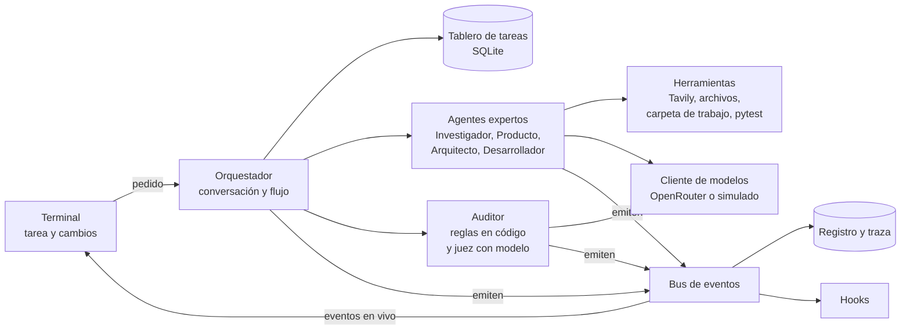
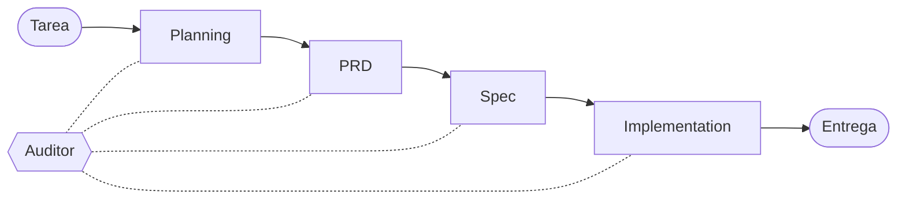
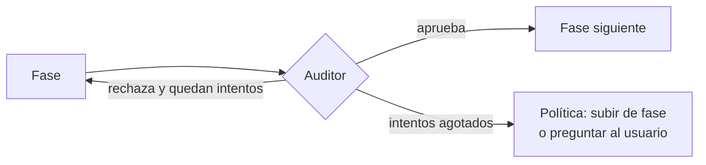

# Arquitectura de AGORA
**Fecha:** 2026-11-10.
**Alcance:** vista breve de AGORA (Arquitectura de Gestión y Orquestación de Razonamiento
Agéntico) para quien revisa el reto *Research Agent Teams*: qué hace, cómo reparte el trabajo,
cómo audita y cómo se recupera de los fallos. El detalle de cada mecanismo está en
[arquitectura-detalle.md](arquitectura-detalle.md).

---

## 1. Qué hace

AGORA recibe una tarea de software de tamaño medio, escrita en lenguaje natural, como "una API para
consultar una base simulada de inventario". La reparte entre cuatro agentes expertos que la
investigan, la especifican y la construyen, y entrega una solución mínima que funciona (un MVP):
código de Python con sus pruebas, junto con el plan, los requisitos y la especificación que
llevaron a él. El usuario sigue el trabajo en vivo, revisa lo construido y pide cambios.

AGORA no está hecho a la medida de ninguna tarea: la tarea es su entrada.

## 2. Principio de diseño

La solución se basa en la gobernabilidad. El modelo de lenguaje hace el trabajo creativo y
cognitivo: investigar, redactar requisitos, diseñar soluciones y generar código. El sistema
mantiene el control del proceso mediante código: decide el flujo, valida lo producido, cuenta los
intentos y aplica una política explícita ante cada fallo.

Que un solo modelo pueda resolver una tarea completa no la vuelve la mejor ruta si no se puede
observar y, por tanto, mejorar. Dividir el trabajo en fases con salidas estructuradas crea puntos
de control: se sabe en qué fase falló algo, qué regla se rompió y qué se hace después. Todas esas
decisiones están en código que se prueba con un modelo simulado.

## 3. Piezas



- **Orquestador:** conversa con el usuario en *streaming* (la respuesta llega por partes), crea las
  tareas, delega cada una en su agente y aplica la política de re-ejecución.
- **Agentes expertos:** uno por fase. Cada uno recibe artefactos, llama al modelo y entrega un
  artefacto validado.
- **Auditor:** revisa cada artefacto contra reglas antes de que avance.
- **Tablero de tareas:** guarda el estado de cada tarea y la historia de cada intento.
- **Bus de eventos:** cada pieza emite sus eventos una sola vez, y el bus los reparte al registro,
  a la traza, a la terminal y a los *hooks*.

## 4. Flujo y auditoría

Cada fase produce un **artefacto**: un documento estructurado, validado con Pydantic, que consume
la fase siguiente.

| Fase | Agente | Entrega |
|---|---|---|
| Planning | Investigador | Pedidos del usuario, hallazgos con su fuente (web o archivos), supuestos y alcance |
| PRD | Producto | Qué se construye: requisitos con criterios de aceptación |
| Spec | Arquitecto | Cómo se construye: modelos de datos, interfaces, archivos y plan de pruebas |
| Implementation | Desarrollador | Código, pruebas y el resultado de ejecutarlas |



El auditor no es una fase: no produce nada que otra fase consuma, sino veredictos sobre los
artefactos de las demás. Actúa como **compuerta** al terminar cada fase: el artefacto no avanza sin
pasar sus reglas. Revisar solo al final dejaría que un error de los requisitos se propagara hasta el código.



## 5. Trazabilidad y reglas

Los identificadores enlazan las fases: cada pedido del usuario (`ASK`) lo cubre un requisito
(`REQ`), y cada requisito lo cubren una interfaz y una prueba (`T`) con su resultado.

```
ASK-2 "filtrar por categoría"
  └── REQ-2 "GET /products?category=X devuelve solo productos de X"
        ├── interfaz GET /products?category=X
        └── T-2, T-3 → pasan
```

Esa cadena permite que la mayoría de las reglas se verifiquen **en código**, sin modelo: que nada
quede sin cubrir, que ninguna referencia apunte a un identificador inexistente, que cada fuente
citada se haya recuperado de verdad y que las pruebas pasen. Son deterministas, no cuestan tokens y
se prueban con facilidad.

Lo que el código no puede juzgar, como si un criterio de aceptación es verificable, lo juzga un
**modelo distinto** del que generó el artefacto, para evitar que sea juez y parte. Responde una
rúbrica de sí o no con evidencia obligatoria; si cita una línea que no existe, el veredicto se
descarta. Estas reglas solo corren cuando todas las de código pasan.

Las reglas en código garantizan cobertura, no calidad: una prueba puede existir y no comprobar
nada útil. Por eso las pruebas se ejecutan contra el código y el juez revisa que cada una compruebe
su criterio.

## 6. Seguimiento de tareas y re-ejecución

Una **tarea** ("escribir la Spec") puede tener varios **intentos**, y cada intento guarda su
entrada, su salida, su error, el veredicto del auditor, el modelo usado, los tokens y la duración.

Cada tarea sigue una máquina de estados con transiciones validadas en código: `pendiente`,
`en_curso`, `en_auditoría`, `aprobada`, `fallida`, `invalidada` y `esperando_usuario`. Una
transición no permitida, como pasar de `pendiente` a `aprobada` sin artefacto ni auditoría, lanza
un error.

Las tareas forman un grafo de dependencias. Una tarea se ejecuta cuando sus dependencias están
aprobadas, y cuando una tarea produce una versión nueva, todo lo que depende de ella se invalida en
cascada. Las versiones anteriores quedan en el historial.

Los fallos se manejan por capas, cada una con un límite de intentos:

| Capa | Ejemplo | Respuesta |
|---|---|---|
| Llamada externa | Timeout o límite de peticiones | Espera exponencial; los errores permanentes fallan sin reintento |
| Salida del agente | JSON que no pasa el esquema | Reintento con el error de validación como retroalimentación |
| Fase | El auditor rechaza el artefacto | Nuevo intento en la fase donde nace el defecto, con el veredicto |
| Ejecución | Presupuesto de tokens agotado | Se detiene y entrega lo que haya, con su estado |

Un defecto se corrige en **la fase donde nace**, no donde se detecta. Una prueba que falla repite la
implementación con la salida de pytest; un requisito sin prueba repite la Spec. Si los intentos se
agotan, la política sube una fase o pregunta al usuario.

## 7. Observabilidad

Cada evento es una línea JSON con su ejecución, tarea, intento y agente, de modo que el registro de
cada agente es un filtro. Las unidades de trabajo forman un árbol de *spans* (ejecución, tarea,
intento, llamada), como en OpenTelemetry: desde cualquier resultado se recorre hacia atrás la
cadena que lo produjo, y el traceback de cada error queda en el intento que falló.

Durante la ejecución, la terminal muestra ese árbol en vivo, con los intentos rechazados y su
motivo:

```
├── ✓ PRD             Producto        3 REQ
│   └── ✗ intento 1: REQ-3 con criterio no verificable
├── ⟳ Spec            Arquitecto      intento 2/3
│   └── ✗ intento 1: REQ-2 sin prueba
└── ○ Implementation  Desarrollador   pendiente
```

## 8. Ciclo con el usuario

Al terminar, la entrega muestra la cadena `ASK → REQ → pruebas → estado`, los archivos generados,
las reglas que fallaron y el costo. El usuario puede abrir cualquier artefacto, ver la traza o pedir
un cambio.

Un cambio entra por **la fase más temprana afectada**: un requisito nuevo entra por el PRD; un
cambio de fuente de datos, por Planning, porque requiere investigar. El modelo propone la fase, el
código valida que sea una de las cuatro, muestra qué se va a rehacer y pide confirmación antes de
gastar tokens. La cascada rehace lo demás.

## 9. Límites y mejoras

- Los cambios se aceptan solo después de la entrega; aceptarlos a mitad de ejecución requiere
  cancelar tareas en curso.
- La calidad de las pruebas generadas se mediría mejor con *mutation testing*: introducir fallos a
  propósito y comprobar que las pruebas los detectan.
- El juez con modelo debería calibrarse contra ejemplos etiquetados a mano.
- La ejecución del código generado debería aislarse en un contenedor.
- La traza podría exportarse a OpenTelemetry o Langfuse.
